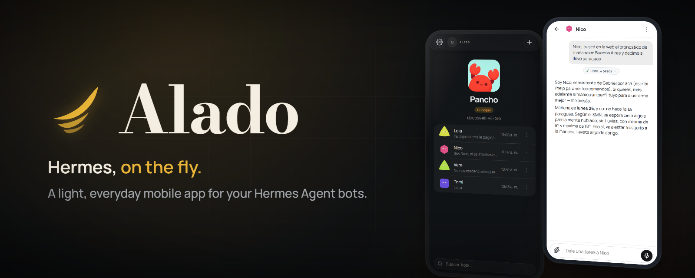
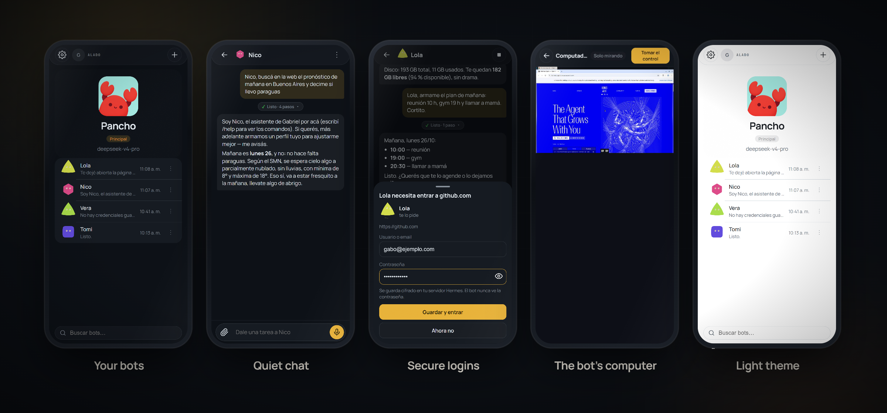

<p align="center">
  
</p>

# Alado — Hermes, on the fly.

<p align="center">
  <a href="https://github.com/gabogabucho/hermes-alado/blob/main/LICENSE"></a>
  <a href="https://github.com/gabogabucho/hermes-alado/actions/workflows/ci.yml"></a>
</p>

**Alado** is a light, everyday Hermes client for your phone — the opposite of a desk app.
It is an installable PWA that connects to your own
[Hermes Agent](https://github.com/NousResearch/hermes-agent) server, so your bots are always
one tap away: on the train, at the market, mid-errand. *Hermes, al vuelo.*

## What is Alado

Hermes Agent gives you autonomous bots with real computers, browsers, approvals and push
notifications — but its own apps are built for sitting down to work. Alado takes the same
backend and turns it into something glanceable and one-handed: chats, groups, approvals,
notifications, voice and quick routines up front; power features a tap behind. It runs on your
server next to Hermes, and you add it to your phone's home screen like a native app.

## Features

- **Your bots on your phone** — chat with any bot profile, with per-bot avatars, titles and
  colors.
- **Create bots** straight from the app — they inherit your main bot's keys and settings.
- **Quiet chat** — while a bot works you see one calm line ("Working…" → "Done · 4 steps"),
  not a wall of tool calls; tap it for the details.
- **Live "working" indicator** — see when a bot is running a turn for you.
- **Secure site logins via Hermes' browser vault** — when a bot needs your login, Alado shows a
  secure form; the bot fills the page but **never sees the password**.
- **The bot's own computer** — watch its desktop live and take control from your phone
  (view / take over / hand back).
- **Groups of bots** — multi-bot rooms from the palm of your hand.
- **Approvals** — approve or reject bot actions wherever you are.
- **Push notifications** — a bot finishing a turn or waiting for you pings your phone
  (via the bundled `droidbot-push` Hermes plugin).
- **Voice** — talk to your bots on the go.
- **Routines** — see and manage each bot's scheduled routines.
- **Dark & light themes** ("hermes" warm near-black + gold, and "clean"), installable PWA,
  offline shell.
- **English and Spanish** — follows your phone's language (switchable in Settings).
- **Bring your bots from GrokBot** — import their personas from an exported file.

## Screenshots

<p align="center">
  
</p>

## Demo

Watch the `alado-demo.mp4` asset on the
[latest GitHub release](https://github.com/gabogabucho/hermes-alado/releases/latest).

## Install

**Requirements:** a Linux server (Ubuntu 22.04/24.04 or Debian 12/13) with sudo access and
ports 80/443 reachable. Tested end to end on a fresh Ubuntu 24.04 with Hermes v0.22.5.

**1. Install Hermes Agent** (official installer — run it as a user with sudo):

```bash
curl -fsSL https://hermes-agent.nousresearch.com/install.sh | bash
```

**2. Install Alado:**

```bash
git clone https://github.com/gabogabucho/hermes-alado && cd hermes-alado
sudo bash provisioner/prepare.sh --all --domain your.domain
```

No domain? The same script gives you HTTPS with your server's public IP, or over Tailscale:

```bash
sudo bash provisioner/prepare.sh --all --access sslip     # https://<public-ip>.sslip.io
sudo bash provisioner/prepare.sh --all --access tailscale # https://<machine>.<tailnet>.ts.net
```

The script first asks you to **create the login you'll use on your phone** (username +
password, stored hashed). Then it runs unattended: it sets up the bot's browser and desktop,
runs `hermes serve` as a service (loopback only, behind Caddy), gets the HTTPS certificate,
installs the app, the push-notification plugin and the companion skill, and restarts Hermes.
No terminal to answer? Pass `--login-user <name>` with the password in `ALADO_PASSWORD`.

**3. On your phone:** open the URL the script prints → log in → install the app
(Android: install prompt / ⋮ → *Install app*; iPhone: Share → *Add to Home Screen*).

**4. Connect your AI provider from the app** if you haven't yet: open your bot → **Vault**
→ add your provider's API key (DeepSeek, OpenRouter, OpenAI, Anthropic…), then **Edit** →
pick the provider and model. (Or on the server: `hermes model`.)

**Updating:**

```bash
git pull && sudo bash provisioner/prepare.sh --all --domain your.domain
```

The `alado-pwa.tar.gz` release asset is downloaded and verified automatically, and
bot-improved skills are kept (never overwritten).

**Troubleshooting:** `sudo bash provisioner/prepare.sh --check` — read-only diagnostics for
every module (exit 0 = all OK). Full detail in
[`docs/provisioner.md`](docs/provisioner.md).

## How it works

- The PWA talks to your Hermes dashboard over **JSON-RPC on `/api/ws`** (the same gateway the
  desktop app uses) plus a few REST calls, all **same-origin through Caddy** — one site, one
  TLS certificate, no CORS.
- The provisioner creates/updates the Caddy site (PWA root + reverse proxy `/api/* /auth/*
  /login*` to the dashboard), installs the `droidbot-push` Hermes plugin (web push), and wires
  the `alado-companion` skill into every bot profile (including `platform_hints.tui`), so bots
  know they are being talked to from Alado and stop pointing at desktop menus.
- Everything the app renders comes from the Hermes backend; there is no third-party service.

## Security model

- **No secrets are stored on the phone.** Session tokens live in memory only. The app keeps just
  non-secret conveniences: the backend URL, theme and language, and a cache of bot names and
  avatars so it opens instantly — never messages, keys or passwords. There is no
  `/api/env/reveal` call anywhere in the client: the PWA never reads your server environment.
- **Credentials only through Hermes' vault prompts.** Logins go through Hermes' own browser
  vault flow: the bot opens the page, Alado shows you a secure form, the vault fills it.
  The bot never sees your password, and nothing is pasted into the chat.
- **Dashboard auth is required** for any public exposure. The provisioner warns (and Hermes
  fails closed) when no auth provider is configured.

## Development

```bash
cd app
npm ci
npm run dev            # HERMES_URL=http://localhost:9119 npm run dev for a local Hermes
```

```bash
npm test                                   # vitest
npx tsc -p tsconfig.app.json --noEmit      # types
npm run lint                               # oxlint
```

Project layout:

```
app/            the PWA (React/Vite)
provisioner/    prepare.sh + README — the one-shot server installer
hermes-plugin/  droidbot_push — web push Hermes plugin (id kept for compatibility)
skills/         alado-companion — skill that teaches bots they live in Alado
docs/           English user/dev docs + media
.github/        CI/release workflows + issue/PR templates
```

## Credits

- [**Nous Research — Hermes Agent**](https://github.com/NousResearch/hermes-agent) (MIT): the
  backend Alado is a client for, and the source of the vendored client files listed in
  [`NOTICE`](NOTICE).
- The alado-companion skill and the droidbot-push plugin live in this repo.

## License

MIT — see [`LICENSE`](LICENSE). Copyright (c) 2026 Gabriel Urrutia.

## Author

**Gabriel Urrutia** — X [@gabogabucho](https://x.com/gabogabucho)
